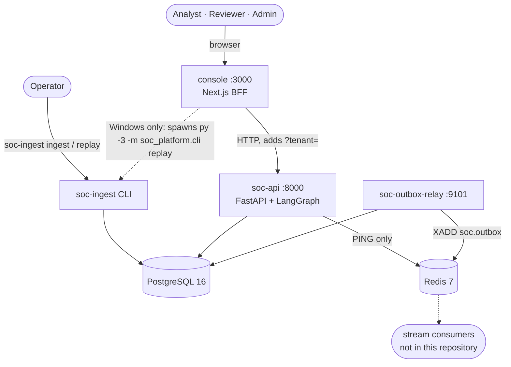
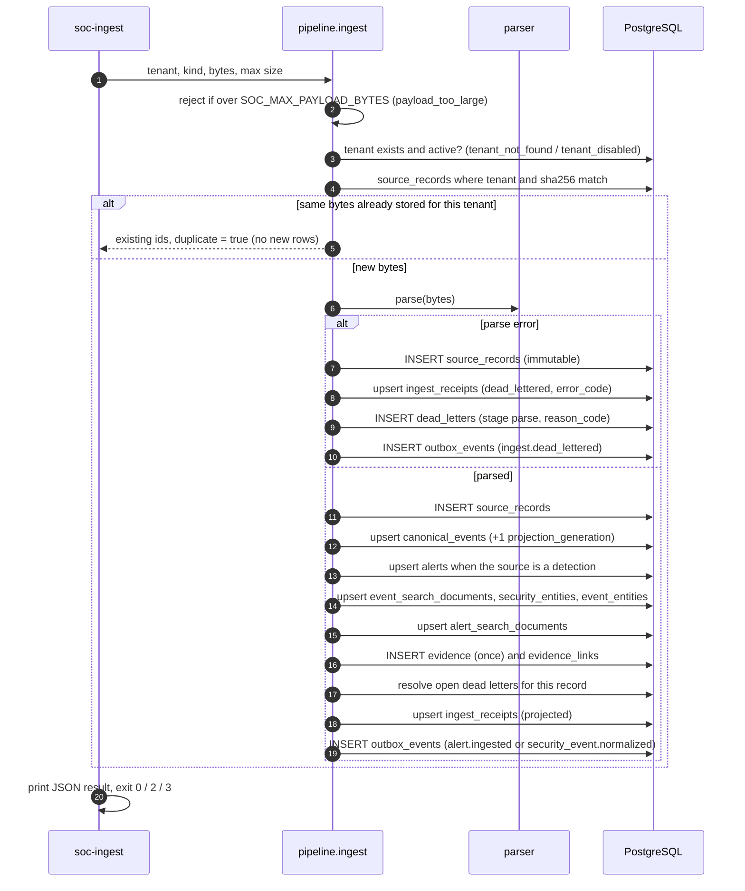
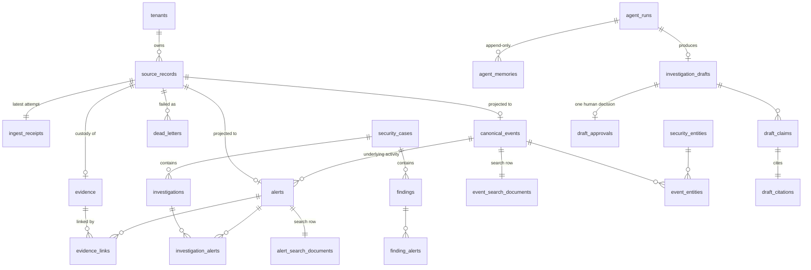
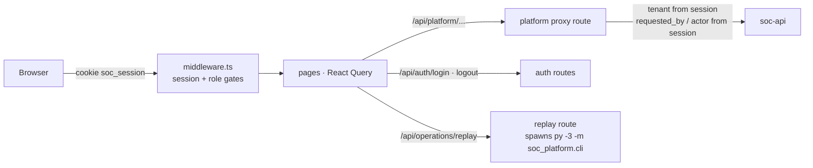

# Architecture

This document describes the platform as it is in the repository (package version `0.6.0`, console `0.5.0`). File references are relative to the repository root.

- [1. System context](#1-system-context)
- [2. Intake pipeline](#2-intake-pipeline)
- [3. Source formats and OCSF normalisation](#3-source-formats-and-ocsf-normalisation)
- [4. Data model](#4-data-model)
- [5. Tenancy, roles and grants](#5-tenancy-roles-and-grants)
- [6. Read API](#6-read-api)
- [7. Search](#7-search)
- [8. Investigation workflow](#8-investigation-workflow)
- [9. Transactional outbox and relay](#9-transactional-outbox-and-relay)
- [10. Console](#10-console)
- [11. Observability](#11-observability)
- [12. Deployment](#12-deployment)
- [13. Design decisions and trade-offs](#13-design-decisions-and-trade-offs)

---

## 1. System context



| Process | Entry point | Port | Database identity | Purpose |
| --- | --- | --- | --- | --- |
| `soc-api` | `uvicorn soc_platform.main:create_app --factory` | 8000 | login role, then `SET LOCAL ROLE soc_reader` or `soc_agent` per request | Read, search, operations and agent routes; `/health`, `/ready`, `/metrics` |
| `soc-ingest` | `soc_platform.cli:main` | none | login role (table owner) | Store, parse and project one payload; replay one stored record |
| `soc-outbox-relay` | `soc_platform.outbox.relay:main` | 9101 (metrics) | login role (table owner) | Publish pending outbox rows to a Redis Stream |
| console | `next dev` / `next start` in `console/` | 3000 | none; it calls the API | Pages, sign-in, role gates, proxy to the API |
| migrate | `alembic upgrade head` | none | login role | Schema, triggers, RLS policies, roles and grants |

PostgreSQL is the only system of record. Redis carries the outbox stream and answers readiness and inventory pings; search and agents never touch it.

---

## 2. Intake pipeline

`soc_platform/ingestion/pipeline.py`. The caller owns the transaction (the CLI opens `session.begin()`), so commit publishes the intake and its outbox row together and rollback discards both.



**Deduplication** is per tenant on `(tenant_id, content_sha256)`. A race on the unique constraint `uq_source_records_hash` is caught inside a savepoint and returned as a duplicate.

**Rejections are not stored.** `IngestRejected` covers `payload_too_large`, `tenant_not_found`, `tenant_disabled`, `invalid_payload` and `unsupported_source`. Replay of a missing record raises `source_record_not_found`. The CLI prints the error to stderr and exits `3`.

**Parse errors are stored.** The bytes are kept and a dead letter records the reason. Reason codes produced by the parsers: `empty_payload`, `invalid_encoding`, `invalid_json`, `invalid_xml`, `schema_mismatch`, `missing_timestamp`, `invalid_timestamp`. The CLI exits `2`.

**Replay** (`pipeline.replay`) reads `source_records.payload` and runs the same projection again. It increments `projection_generation` on the event and alert, refreshes search rows and entity links, keeps the alert's workflow `status` and `created_at`, resolves open dead letters for that record, and writes an `ingest.replayed` outbox row. If the bytes still fail to parse, it adds a `replay`-stage dead letter, keeps the existing projection, and writes `ingest.replay_failed`.

**Outbox event types** (`soc_platform/domain/events.py`): `alert.ingested`, `security_event.normalized`, `ingest.dead_lettered`, `ingest.replayed`, `ingest.replay_failed`. Payloads carry identifiers and the content hash, never the raw body.

**Timestamps.** `database_now()` reads `clock_timestamp()` from PostgreSQL so intake times and the relay's `available_at <= clock_timestamp()` check share one clock.

---

## 3. Source formats and OCSF normalisation

### 3.1 Canonical document

`soc_platform/domain/canonical.py` defines a Pydantic model that is a **subset of OCSF 1.5.0**, not a certified full-schema export.

| Field | Meaning |
| --- | --- |
| `class_uid`, `class_name`, `category_uid`, `category_name` | OCSF class and category |
| `activity_id`, `activity_name`, `type_uid`, `type_name` | `type_uid = class_uid × 100 + activity_id` |
| `severity_id`, `severity` | 0 unknown, 1 informational, 2 low, 3 medium, 4 high, 5 critical |
| `status_id`, `status` | outcome: 0 unknown, 1 success, 2 failure, 99 other |
| `time` | epoch milliseconds |
| `metadata` | `version`, `uid` (the event id), `logged_time`, `original_time`, `product`, `profiles` (`host`, `security_control`) |
| `user`, `device`, `process` (with `parent_process` and hashes), `file`, `src_endpoint`, `dst_endpoint` | entities |
| `observables` | derived list of user, hostname, ip, domain, port, process_name, hash, file_path values |
| `attacks` | ATT&CK technique and tactic references |
| `unmapped` | source fields with no OCSF home (Windows `fields`, `channel`, `record_id`, `sigma_rule_id`, …) |
| `soc` | platform custody extension: `source_record_id`, `source_kind`, `normalizer_version`, `content_sha256` |

### 3.2 Sigma rule-match JSON (`sigma_alert`)

| Input | Used for |
| --- | --- |
| `rule.title` (or top-level `title`) | alert title; required |
| `rule.level` (or `level`, `severity`) | severity: informational/info, low, medium/med, high, critical/crit, unknown |
| `rule.tags` | `attack.tNNNN[.NNN]` become techniques (upper-cased); other `attack.*` tags become tactics |
| `rule.id`, `rule.description`, `rule.logsource.product` | rule id, description, product |
| `alert_id`, `match_id`, `detection_id`, or `id` when it differs from the rule id | external id |
| `event`, `match`, or `matched_event` | the log that matched |
| `detected_at`, `timestamp`, `time`, `@timestamp` | detection time; falls back to the matched event's time |

When the matched event looks like Windows (`winlog`, `Event`, or `System.EventID`), the canonical event is that **Windows activity** (for example Process Activity: Launch) and the rule's techniques and tactics are attached to it. Otherwise the canonical event is a **Detection Finding** (`class_uid 2004`, Create). The alert keeps the rule's level as its severity, while the canonical event keeps the activity's own severity, so a `high` Sigma alert can point at an `informational` process launch.

### 3.3 Mock EDR alert JSON (`mock_edr_alert`)

A stand-in vendor format, not a real EDR SDK. Required: `alert_id`, `title`, `detected_at` (or `timestamp`). Optional: `severity`, `description`, `vendor`, `product`, `technique_ids`, `tactics` or `tactic`, `device{id, hostname, ip, os, domain}`, `user` (string or `{name, domain, uid}`), `process{pid, name, path, command_line, sha256, parent{…}}`, `network{src_ip, src_port, dst_ip, dst_port, dst_hostname}`. The class is Process Activity when a process is present, Network Activity when only network fields are present, and Detection Finding otherwise.

### 3.4 Windows events (`windows_event`)

Three shapes are accepted: **Event XML** (UTF-8, or UTF-16 with a byte-order mark), **Event JSON** (`{"Event": {"System": …, "EventData": …}}` or the same without the `Event` wrapper), and **Winlogbeat JSON** (`winlog.event_id`, `winlog.event_data`, `@timestamp`). Timestamps with `Z`, seven fractional digits, or offsets without a colon are normalised.

| Provider | Event ID | OCSF class | Activity | Outcome | Severity |
| --- | --- | --- | --- | --- | --- |
| Security | 4624 | Authentication (3002) | Logon (1) | success | informational |
| Security | 4625 | Authentication | Logon (1) | failure | medium |
| Security | 4634, 4647 | Authentication | Logoff (2) | success | informational |
| Security | 4688 | Process Activity (1007) | Launch (1) | success | informational |
| Security | 4689 | Process Activity | Terminate (2) | success | informational |
| Security | 4720 | User Management (3007) | Create (1) | success | informational |
| Security | 4726 | User Management | Delete (99) | success | medium |
| Security | 4732 | Group Management (3006) | Add Member (99) | success | medium |
| Eventlog | 1102 | Event Log Activity (1008) | Clear (99) | success | high |
| Service Control Manager | 7045 | Application Lifecycle (6002) | Install (99) | success | medium |
| Sysmon | 1 | Process Activity | Launch | success | informational |
| Sysmon | 3 | Network Activity (4001) | Open (1) | success | informational |
| Sysmon | 5 | Process Activity | Terminate | success | informational |
| Sysmon | 11 | File System Activity (1001) | Create (1) | success | informational |

Any other event ID becomes a **Base Event** (`class_uid 0`, activity 99, outcome unknown) with severity from the Windows `Level` (1 critical, 2 medium, 3 low, otherwise informational). Fields used: `TargetUserName`/`SubjectUserName`/`User`, `TargetDomainName`/`SubjectDomainName`, `NewProcessName`/`Image`/`ProcessName`, `CommandLine`, `NewProcessId`/`ProcessId` (hex accepted), parent process fields, `Hashes`, `TargetFilename`, `IpAddress`/`SourceIp`, `DestinationIp`, ports and `WorkstationName`. The external id is `Computer:Channel:EventRecordID`.

### 3.5 Alert correlation keys

| Source | `correlation_key` |
| --- | --- |
| Sigma | `sigma:{rule_id or title}:{host}:{DOMAIN\user}` |
| EDR | `edr:{first technique or title}:{host}:{process sha256 or name}` |

Alerts are also deduplicated by `dedup_key` (the content hash) per tenant. The correlation key is indexed but nothing groups alerts by it yet.

---

## 4. Data model

24 tables across six migrations. Every tenant-owned table has `tenant_id` and a `UNIQUE (tenant_id, id)` pair, and every child references its parent through a **composite** `(tenant_id, parent_id)` foreign key, so a row cannot point across tenants even if a query forgets the filter.



| Group | Tables | Notes |
| --- | --- | --- |
| Root | `tenants` | `slug` unique; `status` active or disabled |
| Custody | `source_records`, `ingest_receipts`, `evidence`, `evidence_links` | `source_records` and `evidence` are immutable (trigger `soc_reject_mutation`). `byte_size = octet_length(payload)` and `content_sha256 = encode(digest(payload,'sha256'),'hex')` are check constraints. An `evidence` insert must match its source record's hash (trigger `soc_evidence_hash_matches`). |
| Projections | `canonical_events`, `alerts` | Rebuilt by replay. `projection_generation >= 1`. Alert `status` (new, in_review, closed, suppressed) survives replay. GIN index on `alerts.technique_ids`. |
| Casework | `security_cases`, `investigations`, `findings`, `investigation_alerts`, `finding_alerts` | Case statuses open, investigating, contained, recovered, closed. Investigation priority p1 to p4. Finding `confidence` 0 to 100. |
| Operations | `dead_letters`, `outbox_events` | A dead letter needs a source record, an outbox row or bytes; resolved by replay, never deleted. Outbox delivery is at least once. |
| Search | `event_search_documents`, `alert_search_documents`, `security_entities`, `event_entities` | `search_vector` is a stored generated column `to_tsvector('simple', search_text)` with a GIN index |
| Agent workspace | `agent_runs`, `agent_memories`, `investigation_drafts`, `draft_claims`, `draft_citations`, `draft_approvals` | `investigation_drafts.source_of_truth = false` is a check constraint. One approval per draft (`uq_draft_approvals_draft`). Claim templates are a check constraint. |

`agent_runs.alert_id` deliberately has no foreign key (migration `a1c9e4f80b26`), so a failed run can record an alert id that does not exist.

---

## 5. Tenancy, roles and grants

### 5.1 Row-level security

All 24 tables have RLS enabled with the same policy:

```sql
CREATE POLICY tenant_isolation ON <table>
  USING      (tenant_id::text = current_setting('soc.tenant_id', true))
  WITH CHECK (tenant_id::text = current_setting('soc.tenant_id', true));
-- tenants uses id instead of tenant_id
```

RLS is enabled but not forced, so the table owner (the login role the processes connect as) bypasses it. The API therefore never queries as the owner:

```python
# soc_platform/api/reader.py
session.execute(text("SET LOCAL ROLE soc_reader"))      # or soc_agent for workflow routes
session.execute(text("SET LOCAL row_security = on"))
session.execute(text("SELECT set_config('soc.tenant_id', :tenant_id, true)"), {...})
```

`SET LOCAL` lasts for the transaction, so a pooled connection returns to the login role after rollback or commit. Before every read, `assert_reader()` checks `current_user` is a scoped role and `soc.tenant_id` equals the requested tenant, and raises otherwise. A tenant that does not exist, or is not visible under RLS, returns `404 tenant_not_found`.

### 5.2 Roles

| Role | Login | RLS | Grants | Used by |
| --- | --- | --- | --- | --- |
| login role (`soc` in Compose) | yes | owner, bypasses | owns all tables | CLI, relay, migrations, inventory metrics |
| `soc_reader` | no | enforced | `SELECT` on read models, search tables and the agent workspace; `source_records` metadata columns only (no `payload`); `dead_letters` without `payload_bytes`; `outbox_events` without `payload`, `available_at`, `redis_message_id`; `ingest_receipts` | read, search and operations routes |
| `soc_agent` | no | enforced | `SELECT` on the same read models and search tables, `source_records` metadata columns; `SELECT, INSERT, UPDATE` on the six workspace tables | `POST /agent/runs`, `POST /agent/drafts/{id}/decisions` |
| `soc_app` | no | enforced | DML on Phase 1 tables | created, not used by any process |
| `soc_relay` | no | bypasses (`BYPASSRLS`) | DML on Phase 1 tables | created, not used; the relay connects as the owner |

`soc_agent` has no write grant on alerts, events, findings, cases, investigations or evidence, so the workflow cannot change a canonical record even through a bug.

---

## 6. Read API

`soc_platform/main.py` mounts four routers under `/api/v1`: read (`api/routes.py`), search (`api/search_routes.py`), agents (`api/agent_routes.py`) and operations (`api/operations_routes.py`). Health routes are added outside the schema.

- **Query allow-list.** Each route declares a Pydantic query model. `allow_query()` rejects any parameter that is not a field of that model or `tenant`, with `422 invalid_filter`.
- **Error envelope.** `api/errors.py` maps every error, including validation, 404, 405 and unexpected exceptions, to `{"error": {"code", "message", "details?"}}`.
- **Time windows.** `start` is inclusive and `end` exclusive; both must carry a timezone offset, and `start` may not be after `end`.
- **Ordering.** Events by `event_time`, alerts by `detected_at`, findings by `created_at`, cases and investigations by `opened_at`, evidence by `collected_at`, runs and drafts by `created_at`, dead letters and publications by `created_at`, all descending with `id` as the tie-breaker.

### 6.1 Cursors

`api/pagination.py`. A cursor is `base64url(body).base64url(HMAC-SHA256(SOC_API_CURSOR_SECRET, body))`.

| Version | Used by | Body |
| --- | --- | --- |
| `v: 1` | collections, runs, drafts, operations | `resource`, `filters` (tenant, every filter, limit), `us` (sort time in microseconds), `id` |
| `v: 2` | search | the same, plus `rank` for severity sorts (`us` is null then) |

A cursor is refused with `400 invalid_cursor` when the signature fails, the version or resource differs, or **any filter, the tenant or the limit differs** from the request it came from. The next page uses a keyset predicate `(sort, id) < (cursor.sort, cursor.id)`.

---

## 7. Search

### 7.1 Projections

| Table | One row per | `search_text` built from |
| --- | --- | --- |
| `event_search_documents` | canonical event | user, host, message, Sigma rule id, process name/path/command line, parent name/path, file name/path, every IP |
| `alert_search_documents` | alert | title, rule name, rule id, description, plus the linked event's text |
| `security_entities` | (tenant, type, normalised value) | the display value |
| `event_entities` | event-entity link | rebuilt on every projection |

Entity types are `user`, `host`, `process`, `file` and `ip`. The normalised value is case-folded with whitespace collapsed. After each projection the affected entities' `event_count`, `first_seen`, `last_seen` and highest `severity` are recomputed from their linked events, and entities left with no events are deleted.

### 7.2 Identifier folding

PostgreSQL's `simple` configuration splits on punctuation, so `203.0.113.45` would become four tokens. `search/text.py` stores each value three ways: as written, as space-separated words, and as one compacted token per path segment and for the whole value:

```text
C:\ProgramData\stage\7z.exe
→ C:\ProgramData\stage\7z.exe  C  C  ProgramData  ProgramData  stage  stage  7z exe  7zexe  CProgramDatastage7zexe
```

`prepare_fts_query()` applies the same folding to the query: a term that contains punctuation becomes its compacted form (`powershell.exe` → `powershellexe`, `203.0.113.45` → `203011345`), and plain words pass through. The result goes to `websearch_to_tsquery('simple', …)`, so all words are required together. A query made only of punctuation matches nothing.

### 7.3 Filters, facets, sorts

| Endpoint | Filters | Sorts (`sort`) |
| --- | --- | --- |
| `/search/events` | `q`, `source`, `severity`, `status` (OCSF outcome), `event_type` (OCSF class name, case-sensitive), `start`, `end` | `event_time` (default), `created_time`, `severity` |
| `/search/alerts` | the same, with `status` as the alert workflow status; time is `detected_at` | the same; `event_time` means detection time |
| `/search/entities` | `q` on the entity value, `entity_type`, and event filters that keep entities linked to a matching event | `event_time` = last seen, `created_time` = first seen, `severity` |
| `/search/facets` | the event filters | none; not paginated |

Facets count the **event** corpus. `event_type`, `severity` and `source` buckets each ignore their own filter and keep the rest; `host` and `user` return the 20 largest buckets.

---

## 8. Investigation workflow

`soc_platform/agents/`. One HTTP request runs one workflow in-process; the LangGraph graph is compiled once per process and has no persistent checkpointer.

### 8.1 Request and transaction

`POST /api/v1/agent/runs` opens a session with `agent_session()`: `SET LOCAL ROLE soc_agent`, tenant scope, then `start_run()`:

1. `requested_by` must be a person (`require_human`), and a `question` that starts with `http://`, `https://` or `ftp://` raises `network_denied` before anything is stored.
2. An `agent_runs` row is inserted with status `running`.
3. LangSmith tracing variables are forced to `false` and the graph runs with `recursion_limit = 40`.
4. The run is marked `completed` or `failed` with `error_code` and `error_message`, and the session commits workspace rows only.

Each node runs inside a savepoint. An exception in a node becomes `agent_failed`; a `NetworkDenied` becomes `network_denied`. Either way a `failure` memory entry is written and the graph routes to the `failure` node, so nothing is approved by accident.

### 8.2 State and nodes

```python
class InvestigationState(TypedDict):
    alert_id: str | None
    question: str | None
    plan: list[str]          # ["triage", "entity", "threat", "reporting"]
    cursor: int
    failed: bool
    error_code: str | None
    error_message: str | None
    draft_id: str | None
    memory: Annotated[list[dict], operator.add]   # append-only
```

| Node | Does | Tools |
| --- | --- | --- |
| supervisor | On cursor 0 writes the plan to memory; `route()` then picks the next specialist from the plan, `failure` when `failed`, or `end` | none |
| triage | With an alert: loads it, its canonical event and its evidence, and proposes alert, technique, event and custody claims. With a question: searches alerts and events. Neither: fails `missing_subject`. Unknown alert: fails `alert_not_found`. | `get_alert`, `get_event`, `list_alert_evidence`, `search_alerts`, `search_events` |
| entity | Extracts entity keys from each event seen so far and looks each up, at most 8 lookups; for a question with no events, searches the catalogue | `event_entity_keys`, `get_entity_by_value`, `search_entities` |
| threat | For each technique on the alerts seen so far (at most 8), searches other alerts and proposes claims for new ones; records `no_stored_technique` when there are none | `search_alerts` |
| reporting | Reloads the cited row for every proposal, keeps those that match, and stores the draft | none (direct reads) |
| failure | Writes a failure memory entry | none |

Search tools return at most 5 hits.

### 8.3 Tools

`ToolRegistry.call()` refuses any name outside this closed tuple and checks every argument for URL schemes or keys named `url`, `uri`, `href` or `endpoint`:

`get_alert` · `get_event` · `search_alerts` · `search_events` · `search_entities` · `get_entity` · `get_entity_by_value` · `event_entity_keys` · `list_alert_evidence`

All nine call the same query functions the read API uses, under the same `assert_reader` guard.

### 8.4 Claims and validation

| Template | Cites | Arguments checked against the stored row | Rendered statement |
| --- | --- | --- | --- |
| `alert.summary` | alert | `title`, `severity`, `status` | Stored alert {id} is titled {title} with severity {severity} and status {status}. |
| `alert.technique` | alert | `technique` is in `technique_ids` | Stored alert {id} records technique {technique}. |
| `alert.no_technique` | alert | `technique_ids` is empty | Stored alert {id} does not record a technique. |
| `event.summary` | event | `message`, `severity`, `event_type` | Stored event {id} is {event_type} with severity {severity}: {message} |
| `entity.summary` | entity | `entity_type`, `display_value`, `event_count`, `severity` | Stored {entity_type} {display_value} is linked to {event_count} events with highest severity {severity}. |
| `evidence.custody` | evidence | `content_sha256`, `evidence_type` | Stored evidence {id} is {evidence_type} with sha256 {hash}. |

Validation failures are `unknown_template`, `citation_kind_mismatch`, `argument_mismatch`, `record_not_found`, `technique_not_stored`, `technique_is_stored` and `stored_value_mismatch`. Duplicate proposals are removed before validation.

| Outcome of reporting | Draft status | Run status |
| --- | --- | --- |
| Any proposal fails validation | `validation_failed` | failed, `validation_failed` |
| No proposals at all | `insufficient_evidence` | completed |
| Every proposal matches | `pending_approval` | completed |

The draft's `summary` is the claim statements joined by newlines, its `severity` is the highest severity among the claims (entity claims included), and its title is `Draft: {first alert title}` or `Draft: {question}`.

### 8.5 Memory

`agent_memories` rows are written in sequence with kinds `plan`, `observation` (tool, arguments, returned records, error), `claim` (proposals) and `failure`. The workspace page and `GET /agent/runs/{id}` show them in order. Memory is workspace state, not evidence.

### 8.6 Human decision

`POST /api/v1/agent/drafts/{id}/decisions` (also as `soc_agent`):

- `actor` must be a person; agent names and `agent`, `system`, `soc_agent`, `soc_reader` are refused with `422`.
- Only `pending_approval` drafts can be decided, and only once (`409 conflict`), backed by a unique constraint.
- A `draft_approvals` row is written and the draft becomes `approved` or `rejected`. Nothing else changes: no finding is created and no alert status moves.

The console adds two rules the API does not enforce: only the reviewer and admin roles may decide, and the session name must differ from the run's `requested_by`. "Request changes" is sent as `rejected` with a note prefixed `[changes-requested]`.

---

## 9. Transactional outbox and relay

`soc_platform/outbox/`. The relay loops: open a transaction, claim up to `SOC_OUTBOX_BATCH_SIZE` pending rows whose `available_at <= clock_timestamp()` with `FOR UPDATE SKIP LOCKED`, `XADD` each to `SOC_OUTBOX_STREAM`, mark it `published` with the Redis message id, commit. When a batch is empty it sleeps `SOC_OUTBOX_POLL_INTERVAL_SECONDS`.

Stream entry fields:

```text
event_id        cd4b392a-f132-4c74-963f-4e6eb892428c        ← dedupe on this
tenant_id       6c1f2b9e-4d7a-4f3e-9b21-0a5c8e7d3f14
event_type      security_event.normalized
aggregate_type  source_record
aggregate_id    499c2462-c3ca-47a2-b7c2-7333d6ffe300
payload         {"alert_id":null,"canonical_event_id":"b895…","content_sha256":"a74f…","dead_letter_id":null,"evidence_id":"51dc…","source_kind":"windows_event","source_record_id":"499c…"}
```

On a Redis or OS error the row's `attempts` increases, `last_error` is kept, and `available_at` moves forward by `min(60, 2^attempts)` seconds. At `SOC_OUTBOX_MAX_ATTEMPTS` the row becomes `dead_lettered` and a `publish`-stage dead letter with `publish_exhausted` is written. Delivery is at least once: a crash between `XADD` and commit republishes the same `event_id`.

---

## 10. Console

`console/` is a Next.js 15 App Router application. It never talks to PostgreSQL; it is a backend-for-frontend in front of the API.



| Piece | Behaviour |
| --- | --- |
| Operators | `lib/operators.ts`: `analyst`, `reviewer`, `admin` with passwords `*-local`, compared in constant time |
| Session | `lib/session-token.ts`: `base64url(JSON claims).base64url(HMAC-SHA256)` with `sub`, `role`, `name`, `tenantId`, `exp` (12 hours); `httpOnly`, `SameSite=Lax` cookie `soc_session`; secret `CONSOLE_SESSION_SECRET`, falling back to `dev-console-session` |
| Middleware | No session: pages redirect to `/login`, APIs return `401`. `/reviews` needs reviewer or admin. `/admin` and `/api/operations/*` need admin. |
| Platform proxy | `app/api/platform/[...path]`: forwards GET and POST, drops any client `tenant` and sets the session's. On `agent/runs` it sends only `alert_id`, `question` and `requested_by = session.name`. On decisions it requires reviewer or admin, refuses when `run.requested_by` equals the session name, requires a note for reject and request changes, and sets `actor = session.name`. |
| Replay | `app/api/operations/replay`: admin only; spawns `py -3 -m soc_platform.cli replay …` in the repository root, which works only where the Windows `py` launcher exists |
| Pages | login, dashboard, alerts, alert detail, cases, case detail, investigations, investigation detail (timeline), entities, entity detail, agent workspace, review queue, administration |
| Sentinel | `components/sentinel/`: a collapsible page guide with nine pages of content, dark and light appearance kept in `sessionStorage`; it explains the page and does not call a model |

---

## 11. Observability

`soc_platform/observability/`.

| Concern | Implementation |
| --- | --- |
| Correlation | `ObservabilityMiddleware` accepts `X-Correlation-ID` or `X-Request-ID` when it matches `^[A-Za-z0-9][A-Za-z0-9._:-]{0,127}$`, otherwise generates a UUID; adds `X-Correlation-ID`, `X-Trace-Id`, `X-Span-Id` to responses; writes one access log per request; probes are not measured |
| Logging | Root logger with a context filter and JSON formatter (`timestamp`, `level`, `logger`, `message`, `service`, `correlation_id`, `trace_id`, `span_id`, `exception`); `SOC_LOG_FORMAT=text` switches to plain text |
| Tracing | One `TracerProvider` per process, resource `service.name`, `service.namespace=asap`, `deployment.environment`; OTLP gRPC exporter only when `SOC_OTLP_ENDPOINT` is set; FastAPI instrumentation (probes and docs excluded) and SQLAlchemy instrumentation |
| Metrics | `prometheus-client`; the API serves `/metrics`, the relay serves its own registry on `SOC_METRICS_PORT` |

**Metric families (31).**

| Kind | Families |
| --- | --- |
| API (3) | `api_request_total`, `api_request_duration_seconds`, `api_errors_total` by method, route template, status |
| Search (3) | `search_requests_total`, `search_duration_seconds`, `search_result_count` by operation (events, alerts, entities, entity, facets) |
| Agents and review (9) | `agent_runs_total`, `agent_run_duration_seconds`, `drafts_generated_total`, `citation_validation_failures_total`, `insufficient_evidence_total`, `review_requests_total`, `draft_approvals_total`, `draft_rejections_total`, `review_duration_seconds` |
| Database and Redis (4) | `db_query_duration_seconds` (select, insert, update, other), `redis_commands_total`, `redis_command_duration_seconds`, `redis_errors_total` |
| Outbox (1) | `outbox_publish_failures_total` |
| Inventory (10) | `dependency_up{component}`, gauges `alerts_total`, `high_severity_alerts_total`, `open_alerts_total`, `active_cases_total`, `investigations_total`, counters `dead_letters_total`, `events_ingested_total`, `events_replayed_total`, `outbox_events_total`; read from PostgreSQL on scrape as the table owner (platform-wide, not per tenant) and cached 15 seconds |
| Pool (1) | `db_pool_connections{state}` checked out, checked in, overflow |

**Dashboards and rules.** `deploy/observability/grafana/dashboards/soc.json` (uid `soc-overview`, title "SOC platform") has 32 panels in 8 rows: API, Search, Pipeline, Alerts and cases, Agent workflows, Review queue, Database and Redis, Logs. `prometheus/alerts.yml` holds the 10 rules listed in the README; `promtool check rules` reports `SUCCESS: 10 rules found`. Grafana is provisioned with Prometheus, Tempo (trace-to-logs into Loki) and Loki (derived `TraceID` field into Tempo).

---

## 12. Deployment

`docker-compose.yml` (project `soc-platform`, 11 services). The image is `python:3.12-slim`, installs the package, and runs as user `soc` (uid 10001); its default command is the relay.

| Service | Image | Host port | Notes |
| --- | --- | --- | --- |
| postgres | `postgres:16-alpine` | 5434 | user, password and database `soc`; volume `soc_pgdata` |
| redis | `redis:7-alpine` | 6379 | |
| migrate | built | | `alembic upgrade head`, then exits |
| outbox-relay | built | 9101 | `SOC_SERVICE_NAME=soc-relay`, OTLP to Tempo |
| api | built | 8000 | Uvicorn factory; health check on `/ready` |
| tempo | `grafana/tempo:2.6.1` | 3200, 4317, 4318 | |
| loki | `grafana/loki:3.3.2` | 3100 | |
| promtail | `grafana/promtail:3.3.2` | | reads the Docker socket |
| prometheus | `prom/prometheus:v2.55.1` | 9090 | 7-day retention; rules mounted at `/etc/prometheus/alerts.yml` |
| alertmanager | `prom/alertmanager:v0.27.0` | 9093 | one receiver, no integrations configured |
| grafana | `grafana/grafana:11.4.0` | 3001 | `admin` / `admin`, sign-up and anonymous access off |

The console is not in Compose; run it on the host with `npm run dev` or `npm run build && npm start`.

---

## 13. Design decisions and trade-offs

| Decision | Why | Cost |
| --- | --- | --- |
| Store raw bytes and treat every other row as a projection | Custody, replay after a parser fix, and an answer to "what exactly did we receive?" | Storage grows with every payload; there is no retention job |
| Parse failures are stored and dead-lettered, not rejected | Nothing is lost silently and a later parser can replay it | A broken feed fills `source_records` |
| PostgreSQL full-text search instead of Elasticsearch or OpenSearch | One system of record, the same RLS for search, and transactional projections | No relevance tuning beyond `websearch_to_tsquery`; large-scale search would need a dedicated engine |
| Templated claims instead of free text | Every sentence maps to one stored row and can be re-checked mechanically | Drafts read like evidence inventories, not narratives |
| Deterministic agents behind LangGraph | The graph, memory, tool registry and validator are in place before any model is trusted | Today the "agents" add no reasoning beyond database reads |
| Validation in the reporting step, with the draft still stored when it fails | A failed validation is visible and auditable | Validation re-reads rows a moment after triage, so a status change in between fails the draft |
| Approval records a decision and changes nothing else | An AI-assisted draft never silently becomes a finding | Analysts create findings separately; there is no HTTP surface for that yet |
| Console as a BFF with a signed cookie | The browser never sees the API or chooses its tenant | Authentication and role rules live in the console, not the API |
| `SET LOCAL ROLE` with a runtime role check | Works with a pooled owner connection and fails closed | Each request and each query function runs a few extra statements |
